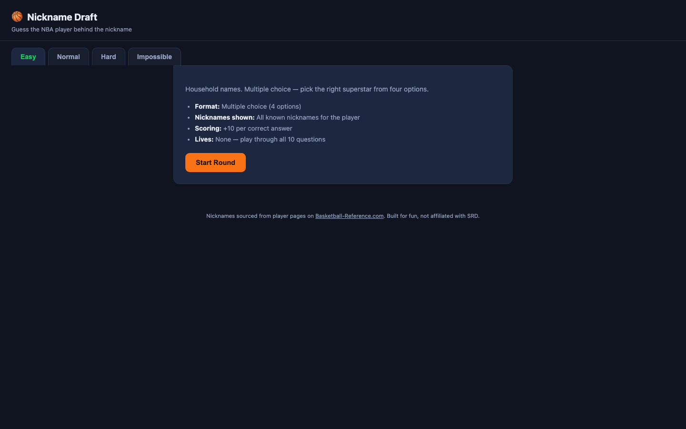

# Nickname Draft

A quick browser game: guess the NBA player behind the nickname. Four
difficulty levels change the format, not just the player pool.

**Live demo:** _add GitHub Pages link here_

## How it plays

| Level | Players | Format | Nicknames shown | Lives | Points (hint cost) |
|---|---|---|---|---|---|
| Easy | Household names | Multiple choice (4 options) | All | None | +10 |
| Normal | Recognizable stars | Type the name | All | None | +15 (−5) |
| Hard | Role players, deep cuts | Type the name | One | 3 | +25 (−10) |
| Impossible | Basketball-Reference deep cuts | Type the name | Most obscure only | 2 | +40 (−20) |

Every round is 10 questions.

## Design notes

<!-- Fill these in. This is the part a UX reviewer reads most closely. -->

- **The idea:** _…_
- **Difficulty design:** _Why scale difficulty by format (multiple choice
  → typed answer) and lives rather than just harder players?_
- **Feedback & iteration:** _Who played it? What confused them?_
- **What I'd do next:** _…_

## How it's built

A single self-contained `index.html` (HTML/CSS/vanilla JS), no build step.
Nicknames sourced from player pages on Basketball-Reference.com.
